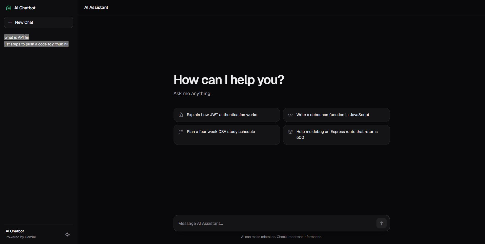
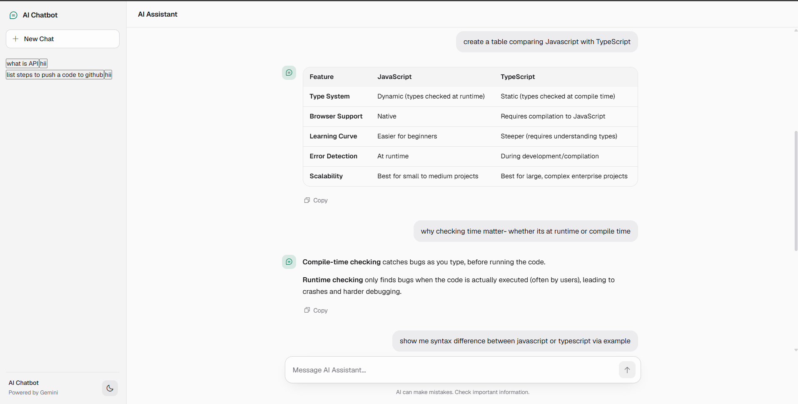

# AI Chatbot

A ChatGPT-style chatbot built to learn backend development. The Node.js/Express backend is written by me. The frontend in `public/` is AI-generated, so the focus of this project is the server side: routing, calling an external AI API, handling conversation state, and storing data in a database.

## Preview





## Features

- Chat with Gemini through a custom Express API
- Full conversation memory: the whole history is sent on every request
- Chat history saved in MongoDB, with a sidebar to reopen old chats
- Markdown responses with syntax-highlighted code blocks and a copy button
- Regenerate response, stop generation, retry on error
- New Chat button
- Light and dark themes
- Responsive layout

## Tech Stack

**Backend:** Node.js, Express 5, MongoDB with Mongoose, Google Gen AI SDK (`@google/genai`), dotenv

**Frontend:** plain HTML, CSS and JavaScript (no framework), marked, highlight.js

## How It Works

```text
Browser (public/script.js)
        |  POST /api/chat  { chatId, messages }
        v
Express server (server.js)
        |  converts history to Gemini format
        v
Gemini API
        |  reply
        v
MongoDB  <- chat saved or updated
        |
        v
Browser  <- { result, chatId }
```

1. The browser sends the full message history and the current `chatId` (null for a new chat).
2. The server maps each message to Gemini's format (`assistant` becomes `model`) and calls the API.
3. The reply is appended to the history and saved in MongoDB: a new document for a new chat, an update for an existing one.
4. The server returns the reply and the `chatId`, and the sidebar list is refreshed.

## API Endpoints

| Method | Route | Description |
| ------ | ----- | ----------- |
| POST | `/api/chat` | Send the message history, get the AI reply, save the chat |
| GET | `/api/chats` | List all saved chats (title and date, newest first) |
| GET | `/api/chats/:id` | Get one full chat |

## Project Structure

```text
chatbot/
├── server.js          # Express app and routes
├── db.js              # MongoDB connection
├── models/
│   └── Chat.js        # Mongoose schema
├── public/            # Frontend (HTML, CSS, JS)
├── screenshots/
├── .env.example
└── package.json
```

## Getting Started

**Requirements:** Node.js, a Gemini API key from [Google AI Studio](https://aistudio.google.com/), and a MongoDB database (local or MongoDB Atlas).

```bash
git clone https://github.com/Agam991/<repo-name>.git
cd <repo-name>
npm install
```

Create a `.env` file in the project root (see `.env.example`):

```text
GEMINI_API_KEY=your_gemini_api_key
MONGO_URI=your_mongodb_connection_string
PORT=3000
```

Start the server:

```bash
node server.js
```

Then open `http://localhost:3000`.

## What I Learned

- Building REST routes with Express and serving a static frontend
- Keeping API keys out of the code with environment variables
- Why chat APIs are stateless, and how conversation memory works by resending the history
- Mapping data between two formats (the frontend's roles vs. Gemini's roles)
- Designing a Mongoose schema and doing create, read and update operations
- Centralised error handling in Express
- Splitting code into modules (`db.js`, `models/`)

## Reference

[Gemini API documentation](https://ai.google.dev/gemini-api/docs)